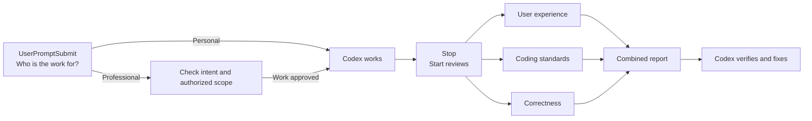

# Codex Work Hooks

Check that a request fits its acceptance criteria before Codex starts work. When Codex tries to finish, three reviewers inspect the result in parallel.

## How it works

Follow an approved work request from left to right:



**UserPromptSubmit** can also pause an out-of-scope request and ask for clarification. Personal requests bypass professional scope grading and enter the same review cycle as approved professional work. For professional changes, only the configured requirements provider may supply scope. Chat text can identify a source or explain a dependency. [Submission policy](src/work_hooks/core/evaluate_submission.py)

**Stop** launches three read-only reviewer processes against the same workspace. Codex saves the combined report in the session’s plugin data directory. Explanation-only and criteria-only turns skip review. [Parallel reviews](src/work_hooks/adapters/codex/reviews.py)

## Requirement sources

The [requirements port](src/work_hooks/ports/requirements.py) returns the current evidence for the session’s work item. A source adapter must authenticate the origin, check who authorized the requirement, and preserve the source reference, revision, author and text. It may combine a ticket with later colleague clarifications. A link or quotation in chat alone proves none of these.

The default provider returns no evidence. Until an authenticated adapter is configured in the composition root, professional implementation is blocked. Explanation and colleague-assistance exceptions remain available.

## Install

With Python 3.10+, an exported `JEV_API_KEY` and a signed-in Codex CLI that supports plugin hooks, install or refresh the plugin from this checkout:

```sh
./install
```

The installer verifies the cached hook files and sends a synthetic personal prompt to Jev from the launching shell. Start a fresh `codex` session and trust the updated Work Hooks entries when prompted. In `/hooks`, the source for “Checking work scope” should match the plugin root printed by the installer.

**Classifier selection.** Jev is the default. Supply `JEV_API_KEY` before starting Codex, or select the Codex classifier with `WORK_HOOKS_CLASSIFIER=codex`. Jev uses Python’s HTTPS client and sends the request, pending request, and acceptance criteria to TypeSafe.

## Try the dispatch scenario

The [dispatch service](tests/fixtures/dispatch_api/service.py) already supports creating and reading manifests in memory. [OPS-17](tests/fixtures/dispatch_api/OPS-17.md) asks for deletion. It is intentionally unimplemented. The [executable scenarios](tests/integration/scope.feature) contain the prompts, expected decisions, and the clarification sequence.

For a manual trial, run `tests/fixtures/dispatch_api/open-chat`. It creates an isolated Codex home, trusts the disposable workspace, installs this checkout, and accepts enabled hooks for that invocation. On macOS it reuses a compatible Python and Codex, installs missing prerequisites using Homebrew/npm when available, and asks privately for a missing TypeSafe key. It reuses file-backed Codex login or opens the supported login flow. Every interactive launch first checks a real Jev submission. First request the endpoint without identifying the ticket. Next submit the ticket text or its path as a separate message. Then ask to implement it. Only the configured fixture supplies requirements in demo mode.

### Run the evaluation

Install the test tools with `python -m pip install -r tests/requirements.txt`. Choose the level according to what you want to verify:

| Level | Command | Observation |
| --- | --- | --- |
| Unit · CI and local | `python -m pytest tests/unit` | Approval and review decisions with controlled inputs |
| Integration · local | `WORK_HOOKS_CLASSIFIER=jev python -m pytest tests/integration` | Real classifier decisions over simulated turns; requires JEV_API_KEY |
| Integration · local | `WORK_HOOKS_CLASSIFIER=codex python -m pytest tests/integration` | Same Gherkin scenarios with a subscribed Codex CLI, Luna at low effort |
| [System scenario](tests/system/codex_submission.feature) · local | `WORK_HOOKS_TEST_AUTH_HOME="$HOME/.codex" python -m pytest tests/system` | Real installed hooks block the first turn, then resume the same read-only chat and acknowledge the selected ticket |

The system test needs file-backed Codex login and Jev credentials. It registers only this checkout in a temporary Codex home and links the existing auth file. Default pytest discovery and GitHub Actions run the unit suite only.

### Diagnose a trial launch

Run `tests/fixtures/dispatch_api/open-chat --check` from the checkout in the same shell used for the trial. This installs a fresh isolated copy and exercises the configured classifier and all three reviewers on synthetic input. It prints the failing stage and exit status. If the account lacks the default Luna model, export `WORK_HOOKS_MODEL` with an available Codex model before retrying.

For an error immediately after sending a message, use `open-chat --check-submit` to check just the submission hook.
