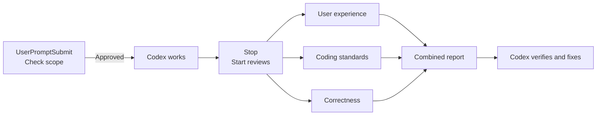

# Codex Work Hooks

Check that a request fits its acceptance criteria before Codex starts work. When Codex tries to finish, three reviewers inspect the result in parallel.

## How it works

Follow an approved work request from left to right:



**UserPromptSubmit** can also pause an out-of-scope request and ask for clarification. Paste acceptance criteria directly into the chat. [Submission policy](src/work_hooks/core/evaluate_submission.py)

**Stop** launches three read-only reviewer processes against the same workspace. Codex saves the combined report in the session’s plugin data directory. Explanation-only and criteria-only turns skip review. [Parallel reviews](src/work_hooks/adapters/codex/reviews.py)

## Install

With Python 3.10+ and a signed-in Codex CLI that supports plugin hooks, run these commands from the checkout:

```sh
codex plugin marketplace add "$PWD"
codex plugin add work-hooks@work-hooks
```

Start Codex normally and review both hook definitions in `/hooks`.

**Classifier selection.** The default classifier uses a fresh Codex process. To use Jev, set `WORK_HOOKS_CLASSIFIER=jev` and supply `JEV_API_KEY` before starting Codex. Jev requires curl 8.3+ and sends the request, pending request, and acceptance criteria to TypeSafe.
