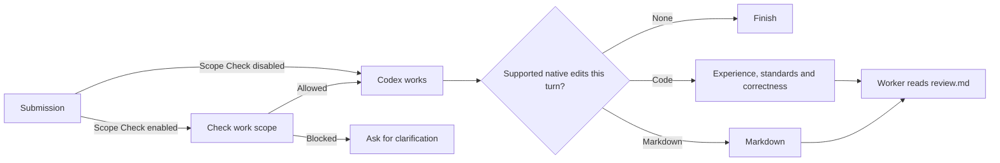

# Codex Work Hooks

Install either plugin from one marketplace. Each has its own hook definitions, prompts, installed files and per-chat data. One repository lets us test their interaction and ship each plugin independently. [Marketplace entries](.agents/plugins/marketplace.json)

| Install | What it does | What it needs |
| --- | --- | --- |
| `./install parallel-review` | Routes native code and Markdown edits to matching reviewers and returns their report to the worker | Codex login and access to the configured reviewer model |
| `./install scope-check` | Checks professional requests against externally authorized requirements before implementation | Codex login with access to `gpt-6-luna` by default |
| `./install both` | Enables both behaviors | Both sets of prerequisites |

## Install with stock Codex

1. Install Python 3.10+ as `python3` and a Codex CLI with plugin hooks. Run `codex login` for local reviewer sessions.
2. Clone the marketplace and change into the checkout.

   ```sh
   git clone https://github.com/ArthurZakirov/codex-work-hooks.git
   cd codex-work-hooks
   ```

3. Scope Check uses your Codex login by default. For the optional Jev classifier, configure its credential below.
4. Run the install command from the table. Open a fresh `codex` and trust the installed plugin hooks when prompted. In `/hooks`, compare the source with the installed path printed by the installer.

**Existing installations.** If upgrading from the combined plugin, remove its old registration with `codex plugin remove work-hooks@work-hooks`, then install your selection. Removing an old plugin can change access to its historical session data. Start a fresh chat for the new plugin IDs.

**Switch later.** Use `/plugins` to manage installed plugins. To remove one explicitly, run `codex plugin remove scope-check@work-hooks` or `codex plugin remove parallel-review@work-hooks`. Rerun its install command to restore it. Start a new session after changing the selection.

## Optional Jev classifier

Set `WORK_HOOKS_CLASSIFIER=jev` in the environment that launches Codex to use Jev.

**macOS, including daemon-backed Codex.** In **Keychain Access**, choose the **login** keychain and create a new password item. Set **Keychain Item Name** to `codex-work-hooks.jev`, set **Account Name** to your macOS username and enter the Jev API key in **Password**. Scope Check looks up that item when its process has no exported key. The login keychain must be unlocked and macOS may ask you to allow access. You can then start stock `codex` normally.

**Shell-based setup.** Supply `JEV_API_KEY` through your usual credential manager or shell environment, then run `codex --no-daemon` from that shell. The embedded server inherits that environment. A shared server already running can have an older environment. If both sources exist, the exported key takes precedence.

**Verification.** Before enabling Scope Check, the installer runs a live synthetic submission from the installation shell. It then checks that the installed plugin files match the tested source. To check the actual launch environment, open a fresh Codex session and ask “Explain what an acceptance criterion is.” If the hook reports a missing credential, confirm the keychain item name and access permissions or use the shell launch above. An HTTP 401 means the provider received the request and rejected the credential. The Jev adapter uses Python HTTPS. [Credential lookup](src/scope-check/work_hooks/adapters/jev_key.py)

## What happens in a turn



**Check work scope.** Personal requests proceed. Professional implementations need verified external requirements. The default requirements provider returns no evidence, so these requests remain blocked until a provider is configured. Questions about existing work, ticket lookup, and drafting or revising team communications can proceed without acceptance criteria. A request that also asks for a feature or refactor still goes through scope grading. Chat text alone cannot authorize implementation. The demo supplies a fixture provider. The default Codex classifier uses `gpt-6-luna` with low reasoning effort. [Submission policy](src/scope-check/work_hooks/core/evaluate_submission.py) · [Requirements port](src/scope-check/work_hooks/ports/requirements.py)

**Parallel Review.** A successful native `apply_patch` call records its patch excerpts under the Codex session and turn IDs. At stop, code goes to experience, standards and correctness reviewers. Markdown goes to the Markdown reviewer. A mixed patch triggers both groups. Each reviewer receives only its assigned excerpts in a temporary workspace. The worker receives one report path and applies confirmed fixes. A repeated stop with no new edits returns immediately. [Supported file types](src/parallel-review/hooks/patches.py) · [Review guidance](src/parallel-review/prompts)

**Review budget.** By default, each user turn gets one review pass. All applicable reviewers run together. The worker applies confirmed fixes and can finish immediately. Its next user request starts a fresh budget. To change the limit, set `max_review_passes` in `$CODEX_HOME/parallel-review.json` (normally `~/.codex/parallel-review.json`). For example:

```json
{"max_review_passes": 2}
```

With `2`, review-guided edits can trigger one verification pass. Use `0` for no passes or `"unlimited"` to keep reviewing while the worker makes new eligible edits. A stop without new edits costs nothing. A failed reviewer launch consumes the attempted pass. Reports remain separate so the worker can identify which pass requested a fix.

**Scope limits.** Discussion, failed patches and pre-existing changes do not trigger reviews. Shell or MCP writes and unrecognized file types are outside this trigger. Use native patches for edits you want reviewed. Reports assess patch evidence; runnable end-to-end UI checks belong in a separate workflow. When installed, the Markdown reviewer also receives the text of `~/.agents/skills/format-markdown/SKILL.md`. To select a different rubric, set `WORK_HOOKS_MARKDOWN_GUIDE` to an absolute Markdown file visible to the hook. Only the Markdown reviewer receives its text.


## Run the evaluations

Install test dependencies with `python3 -m pip install -r tests/requirements.txt`. The following commands run from the checkout.

| Level | Command | What it verifies |
| --- | --- | --- |
| Unit, also in CI | `python3 -m pytest tests/unit` | Scope decisions and controlled adapter failures |
| Integration, local | `python3 -m pytest tests/integration` | Live scope classification and a stand-alone review report |
| System, local | `WORK_HOOKS_TEST_AUTH_HOME="$HOME/.codex" python3 -m pytest tests/system` | Independently installed plugins block or resume a real worker and deliver reviewer findings |

Live reviews use Codex login, a low reasoning effort and the default `gpt-6-luna` model. Set `WORK_HOOKS_MODEL` to an available reviewer model if needed. Integration scope scenarios use Codex by default. System scenarios use disposable Codex homes and need file-backed login for the test worker. [Review integration scenario](tests/integration/review.feature) · [Review system scenario](tests/system/review.feature)

For the interactive demo, run `tests/fixtures/dispatch_api/open-chat`. It prepares the isolated workspace, installs both plugins and checks a live scope submission before opening chat. Use `--check-submit` for just the submission probe or `--check` to also exercise the reviewers. [Sample service](tests/fixtures/dispatch_api/service.py) · [Demo ticket](tests/fixtures/dispatch_api/OPS-17.md)
